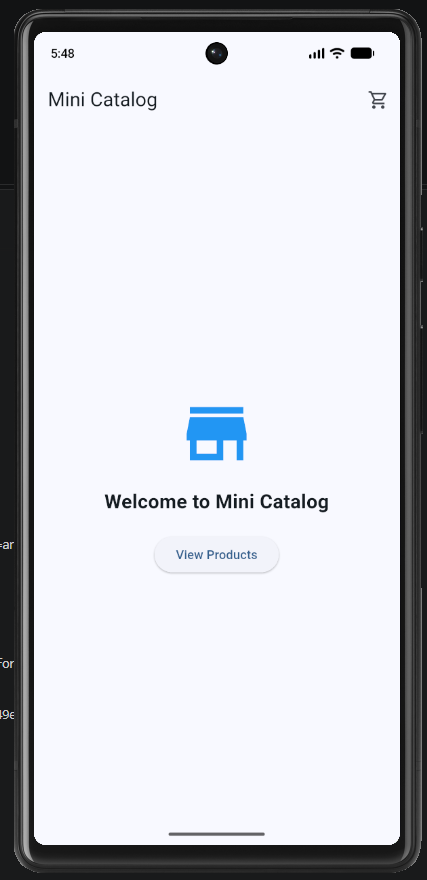
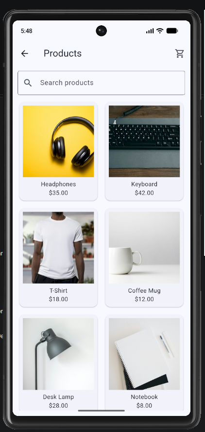
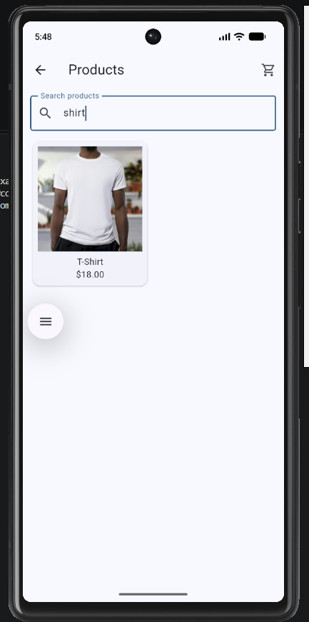
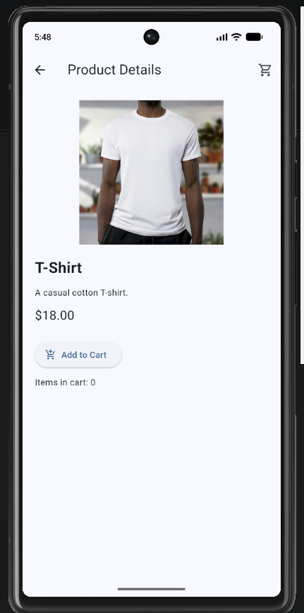
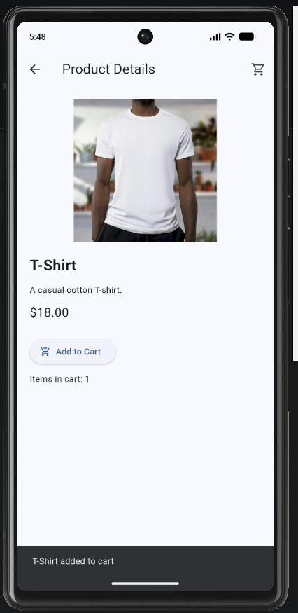
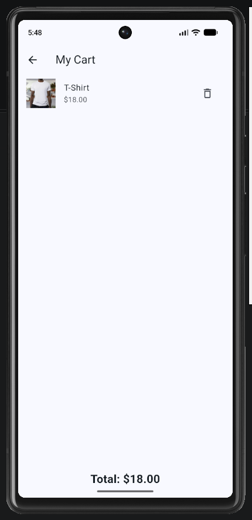
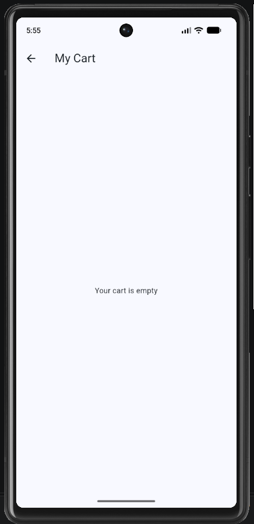

# Mini Catalog

Mini Catalog is a simple Flutter shopping catalog made for a beginner mobile application development project. It lets users browse products, search by name, view product details, and try a basic shopping cart.

## Features

- Home screen with a **View Products** button
- Product grid with six products and real product photos
- Search products by name
- Product details showing an image, description, and price
- Add products to a cart and remove them again
- View cart items and total price
- Product information loaded from a local JSON file
- Page navigation using Flutter's `Navigator`

The cart is only a demonstration. It does not process payments or save items after the app restarts.

## Technologies

- **Flutter:** 3.47.7 (stable)
- **Dart:** 3.13.5
- **UI:** Material Design (`material.dart`)
- **Platform tested:** Android emulator
- **Extra packages:** None

## How to Run

1. Install Flutter and set up an Android emulator.
2. Open the project folder (the one containing `pubspec.yaml`) in VS Code.
3. Start the Android emulator.
4. Open a terminal in the project folder and run:

   ```bash
   flutter pub get
   flutter run
   ```

Product images are saved locally in `assets/images/`, so the app does not need an internet connection once the images are present. If the image files are missing, the included `download_photos.ps1` script can download them on Windows.

## Screenshots

### Home screen


### Product catalog


### Search


### Product details


### Add to cart


### Shopping cart


### Remove from cart


## Project Structure

- `lib/main.dart` — application screens, navigation, search, and cart
- `lib/product.dart` — product data model
- `assets/products.json` — sample product information
- `assets/images/` — product photographs
- `screenshots/` — screenshots of the running app
- `android/` — Android project files

## Photo Credits

Product photos are used for demonstration purposes. See [PHOTO_CREDITS.md](PHOTO_CREDITS.md) for the source links and credits.
